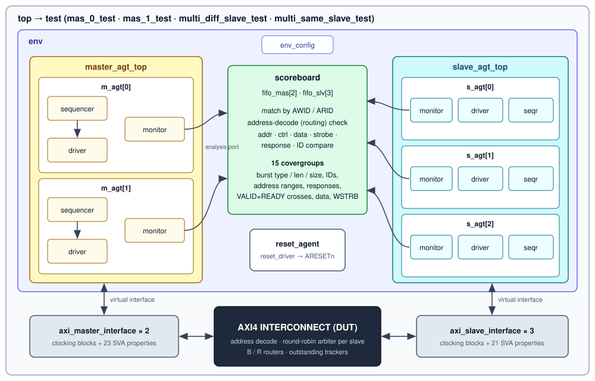
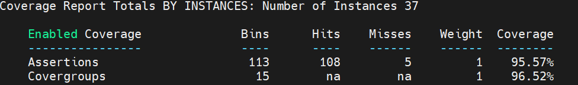
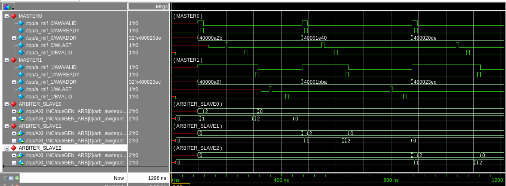
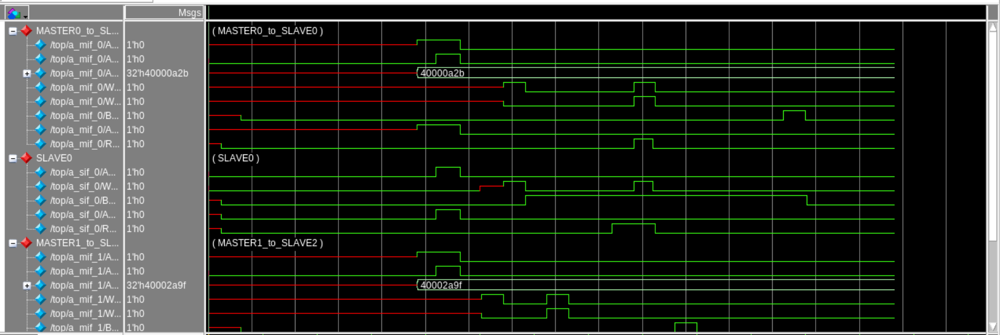
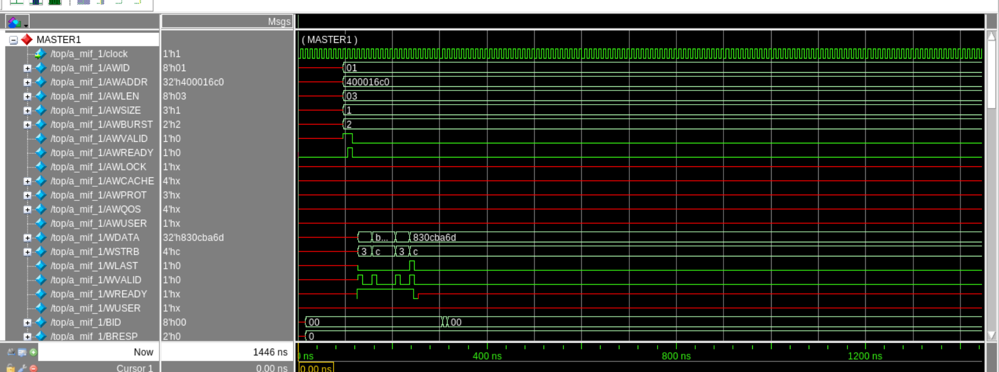
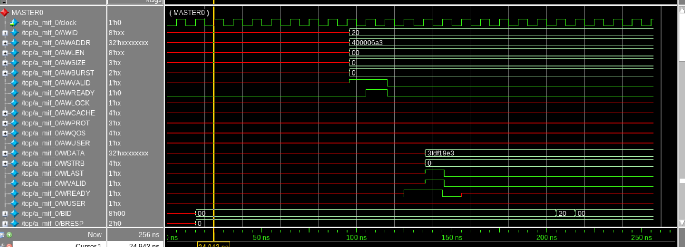

# AXI4 Interconnect (2 Masters × 3 Slaves) — UVM Verification

A **UVM verification environment** for an AMBA AXI4 interconnect that connects **2 masters to 3 slaves**. Two active master agents generate AXI traffic, three active slave agents behave as memory slaves, and a scoreboard matches every transaction seen at a master port with what arrived at the slave port. The environment checks address decoding, routing on all five AXI channels, FIXED/INCR/WRAP bursts, ID-based responses, and **round-robin arbitration** when both masters target the same slave.

**Highlights:**
- 2 master agents + 3 slave agents + reset agent, configured through `env_config` and `uvm_config_db`
- Scoreboard with one analysis FIFO per port, per-ID transaction matching and an address-decode (routing) check
- Tests for single paths, **parallel traffic to different slaves**, and **arbitration on the same slave**
- 23 SVA properties in the master interface and 21 in the slave interface, 15 covergroups
- **24/24 regression runs pass · 96.52% functional coverage · 95.57% assertion coverage · 0 assertion failures**

> The interconnect RTL was provided by Maven Silicon as a training project and is **not included** in this repository. The testbench, interfaces with assertions, tests, coverage model and scripts are my own work.

---

## Tools & Technologies

| Category | Used |
|---|---|
| **Language / methodology** | SystemVerilog, UVM 1.1d, SystemVerilog Assertions (SVA) |
| **Simulator** | Siemens Questa 2024.1 (`vlog` / `vsim`) |
| **Coverage** | Questa `vcover` (merge across tests and random seeds, summary and HTML report) |
| **Waveform debug** | Questa Wave window, with ready-made `.do` scripts for each scenario |
| **Protocol** | AMBA AXI4 (AW, W, B, AR, R channels) |
| **Platform** | Linux, GNU Make |

---

## Design Under Test

| Parameter | Value |
|---|---|
| Masters / slaves | 2 / 3 |
| Data / address / ID width | 32 / 32 / 8 bits |
| Burst types | FIXED, INCR, WRAP |
| Arbitration | Round robin, one arbiter per slave (write address and read address) |
| Outstanding requests | 4 |

| Slave | Address range |
|---|---|
| Slave 0 | `0x4000_0000 – 0x4000_0FFF` |
| Slave 1 | `0x4000_1000 – 0x4000_1FFF` |
| Slave 2 | `0x4000_2000 – 0x4000_2FFF` |

---

## Testbench Architecture

<p align="center"></p>

| Component | File | Role |
|---|---|---|
| `axi_xtn` | [`master_side/master_xtn.sv`](master_side/master_xtn.sv) | AXI transaction with constraints for slave selection, address range, burst type/length/size, WRAP alignment; calculates per-beat addresses and WSTRB |
| `master_driver` | [`master_side/master_driver.sv`](master_side/master_driver.sv) | Drives AW, W, B, AR and R in parallel (`fork…join`), keeping channel order with queues and semaphores |
| `master_monitor` | [`master_side/master_monitor.sv`](master_side/master_monitor.sv) | Captures each write (AW + all W beats + B) and read (AR + all R beats) and writes it to the analysis port |
| Master sequences | [`master_side/master_sequence.sv`](master_side/master_sequence.sv) | `mas_0_seq`, `mas_1_seq`, and the multi-master sequences with separate ID ranges (M0: 1–99, M1: 101–199) |
| `slave_driver` | [`slave_side/slave_driver.sv`](slave_side/slave_driver.sv) | Memory-slave model: gives READY, stores write data per byte lane, returns `BID = AWID`, sends `ARLEN+1` read beats with `RID` and `RLAST` |
| `slave_monitor` | [`slave_side/slave_monitor.sv`](slave_side/slave_monitor.sv) | Captures what reached each slave port and checks WLAST / RLAST on the final beat |
| `reset_agent` | [`tb/reset_agent.sv`](tb/reset_agent.sv) | Drives the interconnect reset at the start of simulation |
| `scoreboard` | [`tb/scoreboard.sv`](tb/scoreboard.sv) | Analysis FIFOs for 2 masters and 3 slaves, ID matching, comparison, covergroups |
| `env` / `env_config` | [`tb/env.sv`](tb/env.sv) | Builds the agent tops, scoreboard and reset agent; connects monitors to the scoreboard |
| Tests | [`test/test.sv`](test/test.sv) | Base test (environment configuration) and the 4 tests below |
| Interfaces | [`interface/`](interface/) | Master and slave interfaces with driver/monitor clocking blocks and SVA |

---

## Verification Plan

### Stimulus
- The sequence selects the target slave through `uvm_config_db`; constraints keep `AWADDR` / `ARADDR` inside that slave's range.
- Burst type, length and size are randomized: FIXED, INCR and WRAP (WRAP lengths 2, 4, 8 … beats, address aligned to the size).
- Transfer size is limited to the 32-bit data bus; WSTRB is calculated from the address and size of every beat.

### Tests
| Test | Scenario |
|---|---|
| `mas_0_test` | Master 0 → Slave 0, write + read |
| `mas_1_test` | Master 1 → Slave 1, write + read |
| `multi_diff_slave_test` | Master 0 → Slave 0 **and** Master 1 → Slave 2 at the same time (parallel paths) |
| `multi_same_slave_test` | Master 0 and Master 1 → the **same** slave, repeated for Slave 0, 1 and 2 (arbitration) |

### Checking (scoreboard)
- Every master transaction is stored by `AWID` / `ARID` and matched with the transaction seen at the slave port.
- **Routing:** a slave must only receive addresses from its own range.
- **Write:** address, LEN/SIZE/BURST, number of beats, every WDATA beat, every WSTRB, BRESP and BID.
- **Read:** address, control, every RDATA beat, RRESP, RID.

### Assertions (SVA)
| Group | Properties |
|---|---|
| Stability | AW, W, AR, B and R signals stay stable from VALID until the handshake |
| Handshake | AWVALID / WVALID / ARVALID stay high until READY |
| Burst rules | No reserved burst type (`2'b11`); WRAP length is 2, 4, 8 … 256 beats; WRAP address aligned to the transfer size |
| Limits | Transfer size within the 32-bit bus; burst does not cross a 4 KB boundary |
| Response | A write address handshake is followed by a write response handshake |

### Functional coverage (15 covergroups)
| Covergroup | Covers |
|---|---|
| `master_covgrp0/1`, `slave_covgrp0/1/2` | Address range per slave, burst type, burst length per type, size, AW/B/AR/R IDs, BRESP, VALID/READY/LAST of every channel, crosses VALID × READY (× LAST) and LEN × SIZE |
| `*_dyn_write_covgrp*` | WDATA value ranges and WSTRB patterns for every beat |
| `*_dyn_read_covgrp*` | RDATA value ranges and RRESP for every beat |

---

## Results

### Regression (Questa 2024.1)
| | |
|---|---|
| Runs | 24 (4 tests + 10 random seeds × 2 multi-master tests) |
| Passed | **24 / 24** |
| UVM_ERROR / UVM_FATAL | **0 / 0** in every run |
| Master → slave paths verified | **all 6** (M0, M1 → S0, S1, S2) |

Per-run table: [`reports/regression_summary.txt`](reports/regression_summary.txt) · Scoreboard output: [`reports/scoreboard_log_excerpt.txt`](reports/scoreboard_log_excerpt.txt)

### Coverage (`vcover`, all runs merged)
| Metric | Score |
|---|---|
| **Functional (covergroups)** | **96.52%** |
| **Assertions** | **95.57%** (108 of 113 exercised, **0 failures**) |
| Total (filtered view) | 96.04% |

<p align="center"></p>

### Waveforms (Questa)

**Arbitration — both masters write to the same slave.** `request = 11` → arbiter grants Master 0 (`grant = 01`) → Master 1 keeps AWVALID high without AWREADY → after Master 0's response the grant moves to Master 1 (`grant = 10`). The same sequence repeats for Slave 1 and Slave 2.
<p align="center"></p>

**Parallel paths — Master 0 → Slave 0 and Master 1 → Slave 2.** Both write addresses are accepted in the same clock: different slaves have separate arbiters, so neither master waits.
<p align="center"></p>

**4-beat WRAP write, Master 1 → Slave 1.** AWLEN = 3, AWSIZE = 1 (2 bytes), WSTRB = `3, c, 3, c`, WLAST on the 4th beat, BID = AWID with OKAY response.
<p align="center"></p>

**Master 0 → Slave 0, write and read.**
<p align="center"></p>

---

## Repository Structure

```
AXI-Interconnect-UVM-Verification/
├── interface/     axi_master_interface.sv, axi_slave_interface.sv  (clocking blocks + SVA)
├── master_side/   master_xtn.sv, master_agt_config.sv, master_driver.sv, master_monitor.sv,
│                  master_sequencer.sv, master_sequence.sv, master_agent.sv, master_agt_top.sv
├── slave_side/    slave_xtn.sv, slave_agt_config.sv, slave_driver.sv, slave_monitor.sv,
│                  slave_sequencer.sv, slave_sequence.sv, slave_agent.sv, slave_agt_top.sv
├── tb/            env_config.sv, env.sv, scoreboard.sv, reset_agent.sv, reset_agt_config.sv, reset_driver.sv
├── test/          test_pkg.sv, test.sv
├── sim/           Makefile, wave scripts (w_m0s0.do, w_m1s1.do, w_parallel.do, w_arbitration.do)
├── reports/       regression_summary.txt, scoreboard_log_excerpt.txt
└── docs/          architecture diagram, waveforms, coverage summary
```

## How to Run (Questa)

The interconnect RTL, the reset interface and `top.sv` are part of the Maven Silicon course material. Place the RTL in `AXI_Interconnect_rtl/` and the top module in `test/top.sv`, then:

```bash
cd sim
make regress     # compile, run the 4 tests, merge coverage
make seeds       # multi-master tests with 10 random seeds
make merge_all   # merged coverage summary + HTML report
make waves       # 4 Questa windows: M0→S0, M1→S1, parallel, arbitration
```

---

## Author

**Dhanush** — RTL Design & Verification Engineer
[LinkedIn](https://www.linkedin.com/in/dhanush-71b36841b) · [GitHub](https://github.com/Dhanush30-DV)

*Verification project completed during Advanced VLSI Design & Verification training at Maven Silicon, Bangalore.*
